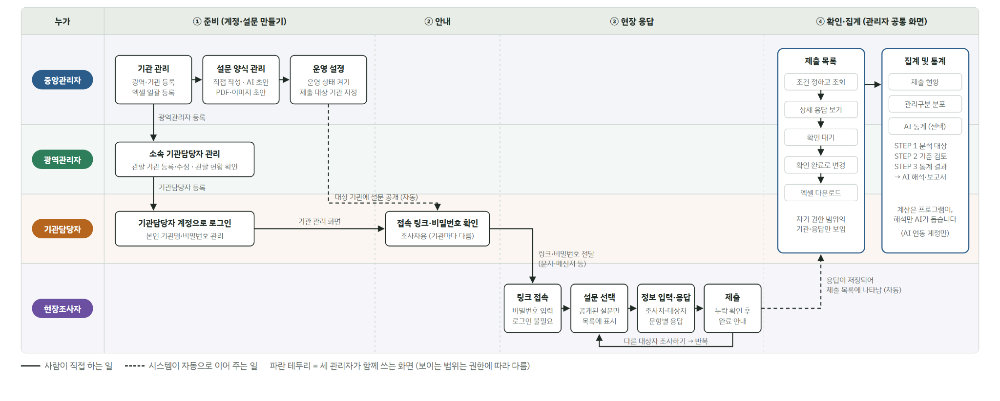

# **응다비:룸 — AI 설문·현장조사 플랫폼**


설문 작성부터 현장 응답 수집, 제출 현황 관리, 통계 및 AI 분석까지 하나의 흐름으로 연결하는 웹 기반 플랫폼입니다.

> ### 도입 전 필수 확인
>
> **아래 준비와 검증을 완료하기 전에는 실제 개인정보를 입력하지 말고 합성·가상 데이터로만 테스트하세요.**
>
> 1. **동의·처리방침:** 적법한 처리 근거를 확인하고, 필요한 설명·동의와 기록 보관을 별도로 운영하며 처리방침을 게시합니다.
> 2. **외부 서비스:** Supabase·Netlify·AI 제공자의 실제 처리 지역·위탁 관계·국외 이전 해당 여부와 필요한 안내·절차를 확인합니다.
> 3. **AI 전송:** 첨부파일·요청문에는 개인정보를 넣지 않습니다. 소수 인원 집계의 식별 위험을 검토하며, 현재 서버의 소수 인원 자동 가림 기능은 없다는 점에 유의합니다.
> 4. **보유·파기:** 보유 기간과 파기·삭제 요청 처리 절차를 정합니다. 화면의 삭제는 숨김 처리이며 감사 기록 사본도 남습니다.
> 5. **기록·다운로드:** 접속·열람·내려받기 기록의 부족한 부분을 확인하고, Excel 파일의 암호화·접근 제한·보관·폐기 규칙을 정합니다.
> 6. **계정 보안:** 초기 비밀번호를 즉시 변경하고, `ALLOW_DEFAULT_PASSWORD_FALLBACK=N`으로 설정합니다. 조사자 비밀번호는 최소 8자 이상으로 기관마다 다르게 정합니다.
> 7. **배포 범위:** 제출본의 빌드로 생성한 `public/`만 정적 배포합니다. 저장소 전체를 웹사이트의 정적 파일로 배포하지 않으며 내부 경로 차단과 정상 기능을 배포 후 확인합니다.
>
> 상세 준비·검증 절차와 미구현 기능은 [관리자 가이드](docs/netlify-supabase-deployment.md)를 확인하세요.
>
> **이 체크리스트는 보안·법적 적합성을 보장하지 않으며 법률 자문이 아닙니다. 도입 기관은 실제 운영 조건에 맞춰 법률 검토를 받아야 합니다.**

## 라이선스

Netlify·Supabase 및 AI 제공자(OpenAI·Anthropic·Google)의 서비스 이용에는 각 사업자의 약관이 적용되며, 이 저장소의 라이선스는 해당 서비스의 이용 권한을 부여하거나 약관을 변경하지 않습니다.

| 적용 대상 | 이용 조건 |
| --- | --- |
| 자체 소스코드 | [Apache-2.0](LICENSE) |
| 자체 문서·프롬프트 | [CC BY 4.0](LICENSE-DOCS) |
| 발표자료·제출 이미지·브랜드 로고·캐릭터 | 위 라이선스의 일괄 적용 대상에서 제외하는 구체적인 파일·내용과 기존 허락 보존 원칙을 [NOTICE](NOTICE)에 명시했습니다. 별도 권리·허락을 확인하세요. |
| 제3자 라이브러리·아이콘·폰트 등 | 각 구성요소의 원래 라이선스 유지. [THIRD_PARTY_NOTICES.md](THIRD_PARTY_NOTICES.md) 및 동봉 고지 참조 |

이는 파일 종류별 적용 범위이며, 동일한 자료에 Apache-2.0과 CC BY 4.0 중 하나를 임의 선택하는 방식이 아닙니다. 과거 배포본에서 적법하게 부여된 이용허락은 소급 철회하지 않습니다. 브랜드 식별자 사용에 대한 상표·출처 오인 문제는 코드 이용허락과 별개입니다.

**코드 내부 프롬프트의 적용 범위:** 아래 파일에 포함된, 프로젝트가 작성한 **AI에 전달하는 자연어 지시문·프롬프트 템플릿의 문장 부분**은 CC BY 4.0을 적용합니다. 그 외 실행 로직·API 호출·데이터 처리·검증 코드·템플릿 변수 삽입 처리 등은 Apache-2.0을 적용합니다.

- [netlify/functions/api-legacy.cjs](netlify/functions/api-legacy.cjs)
- [netlify/functions/lib/analysis-report.js](netlify/functions/lib/analysis-report.js)
- [netlify/functions/lib/analysis-recommend.js](netlify/functions/lib/analysis-recommend.js)
- [netlify/functions/lib/account-ai.js](netlify/functions/lib/account-ai.js)

파일 전체에 CC BY 4.0을 적용하거나 두 라이선스 중 하나를 선택하는 방식이 아닙니다. 실행 중 삽입되는 사용자 입력·첨부자료·조사 데이터에는 이 고지로 새로운 이용허락을 부여하지 않습니다. 상세 범위는 [NOTICE 2절](NOTICE)을 확인하세요.

소스코드와 관련 문서는 별도 압축파일이 아닌 저장소 루트의 개별 파일과 폴더로 제공합니다. GitHub에서 직접 열람하거나 저장소를 복제(Clone)하여 사용하고, [소스 설치·실행 안내](SOURCE_README.md)와 [관리자 배포 안내](docs/netlify-supabase-deployment.md)를 확인하세요. 배포 대상은 저장소 전체가 아니라 빌드로 생성되는 `public/`입니다.

## **1. 팀 기본 정보**

### **1.1 기관 정보**

| 구분 | 내용 |
| ----- | ----- |
| 기관명 | 독거노인종합지원센터 |
| 기관 소개 |  독거노인종합지원센터는 모든 어르신이 안전하고 존엄한 노후를 보낼 수 있는 사회를 실현하기 위해 설립된 보건복지부 위탁 중앙노인돌봄지원기관입니다. 전국 노인맞춤돌봄서비스의 운영을 총괄 지원하며, 정책 기획, 수행기관 관리, 종사자 교육, 정보시스템 운영, 조사·연구 등을 수행하고, 취약 노인들의 사회적 관계 형성을 돕는 사랑잇기사업도 이어가고 있습니다.  현장에서는 어르신의 생활·안전 상태와 돌봄 욕구를 파악하는 조사를 진행하고, 기관별 조사 결과를 취합·분석하여 서비스 운영과 지원 방향을 개선하는 데 활용합니다. |
| 팀명 | 응다비:룸 |

### **1.2 팀 구성원 정보**

| 구분 | 이름 | 소속·직책 | AI 챌린지 해에서의 담당 역할 |
| ----- | ----- | ----- | ----- |
| 팀장 | 김수진 | 정보화팀 팀장 | 프로젝트 총괄, 시스템·DB 구조 설계, Netlify·Supabase 배포 환경 구성, 브랜치·PR 통합 및 최종 병합, 보안(계정별 AI 키 암호화·권한 검증) 구현 |
| 팀원 | 맹혜령 | 운영지원부 차장 | 문제 정의·요구사항 확정, 기관 운영 관점 검토, 시범 운영 조율 및 성과 확인 |
| 팀원 | 유병덕 | 교육운영팀 팀장 | AI 설정 기능 구현, UI·UX 개선, 현장 관점 화면 설계, 랜딩 페이지 및 사용자 가이드 제작 |
| 팀원 | 김정아 | 정보화팀 주임 | 집계 및 통계 기능 구현, 설문 집계 보완, 사용자 테스트 및 의견 수렴 관리 |

## **2. AI 솔루션**

### **2.1 문제 정의**

여러 기관이 참여하는 조사에서는 설문을 만드는 일뿐 아니라 조사 안내, 응답 취합, 제출 여부 확인, 결과 정리까지 반복적인 관리 업무가 발생합니다. 특히 기관별 담당 범위가 다른 상황에서는 누가 어떤 설문에 응답해야 하는지, 어느 기관에서 제출한 응답인지, 누가 결과를 조회할 수 있는지 일관되게 관리해야 합니다.

응다비:룸은 이러한 과정을 한 시스템으로 연결하고, 설문 초안 작성과 결과 해석에 AI를 선택적으로 활용하도록 기획했습니다. 특정 기관의 고정된 조사 양식만 운영하는 방식에서 벗어나 사용자가 업무에 맞는 설문을 작성하고 운영하는 것을 지향합니다.

- 주요 이용자: 조사 운영을 총괄하는 중앙담당자, 기관담당자를 지원하는 광역관리자, 기관별 기관담당자, 현장조사자

#### **문제를 겪는 이용자**

- **중앙 담당자**(우리 사례: 독거노인종합지원센터): 새 조사 체계를 만들 때마다 용역 예산과 개발 기간이 필요해 현장 요구를 적시에 반영하기 어려움
- **광역·지역 단위 관리 담당자**(광역지원기관·수행기관): 기관마다 다른 양식으로 들어온 자료를 다시 취합·검증하는 데 많은 시간을 투입하고, 상위 기관에 별도로 다시 제출
- **현장 인력**(전담사회복지사, 생활지원사 등): 종이 조사표를 들고 다니며 기록하고 사무실에서 다시 입력하는 이중 작업
  같은 구조의 문제는 사회복지관·자활센터 등 다기관 사업, 지자체–읍면동–통반 조사, 협회–지회–회원기관 현황 조사처럼 **여러 단계의 조직이 함께 조사하는 곳이면 어디서나** 반복됩니다.
- 해결하려는 문제: 반복적인 응답 취합과 현황 확인, 기관별 접근 범위 관리, 설문 작성 및 분석 준비의 부담

#### **기존 방식과 한계**

| 기존 방식 | 문제점 | 영향 |
| ----- | ----- | ----- |
| 시스템 개발 용역 | 항목 하나를 바꾸려 해도 요구사항 정의→발주→개발→검수까지 수개월 | 정책·조사 적용 시점을 놓치고, 비용 부담이 큼 |
| 서면·엑셀·별도 설문 | 기관별 양식과 기준이 달라 취합 시 재입력·재검증 필요 | 데이터 신뢰도 저하, 기관 → 광역 → 중앙의 취합 시간 증가 |
| 범용 설문 도구 | 기관 계층(중앙-광역-기관)별 권한과 조회 범위, 모바일 현장조사, 기관별 통계를 한 흐름으로 지원하지 못함 | 개인정보가 담긴 조사 결과를 외부 도구에 흩어 관리 |

  (예) 2026년 퇴원환자 단기집중서비스 평가 연구 관련 수행기관 설문
  설문조사 프로그램 개발비용 1,500,000원 비용 발생 / 프로그램 개발 기간 1개월 소요 / 현장 생활지원사가 이용자 대상으로 설문 실시하여 제출 → 기관 담당자 취합하여 제출 → 광역지원기관 취합하여 제출 → 중앙 담당자 최종 취합까지 이후 3개월 소요

- 현장의 중요성:

수행기관에는 동일한 기준으로 데이터를 수집·관리할 체계가, 현장에는 쉽고 편리하게 조사·기록할 환경이 필요합니다. 이것이 갖춰져야 전달체계 전반의 업무 효율이 높아지고, 신뢰할 수 있는 데이터를 바탕으로 도움이 필요한 어르신을 더 빨리 찾아 지원으로 연결할 수 있습니다.

### **2.2 AI 솔루션 소개**

#### **솔루션 개요**

응다비:룸은 **설문 생성 → 현장 응답 수집 → 제출 현황 관리 → 통계 및 AI 분석**을 하나의 웹 서비스로 연결합니다. 중앙관리자가 설문을 직접 작성하거나 AI로 초안을 만들어 검토·운영하면, 기관담당자가 현장조사자에게 기관별 링크를 안내하고, 현장조사자는 스마트폰 브라우저에서 로그인 없이 응답을 제출합니다. 관리자는 권한 범위 안에서 제출 목록·통계를 확인하고 AI에게 분석 기준 추천과 결과 해석을 요청할 수 있습니다.



| 역할 | 주요 업무 | 조회 범위 |
| ----- | ----- | ----- |
| 중앙관리자 | 기관 관리, 설문 작성(AI 초안 작성 등) 및 운영, 제출 대상 기관 지정 | 전체 기관 |
| 광역관리자 | 관할 기관 관리, 진행 현황 및 통계 확인 | 관할 기관 |
| 기관담당자 | 현장조사자 링크 안내, 제출 기본정보 수정, 확인 완료 처리 | 내 기관 |
| 현장조사자 | 전용 링크로 접속해 대상자 정보와 설문 응답 입력 | 제출 화면 |

**여러 조직에 맞출 수 있는 권한체계.** 4개 역할은 특정 기관의 직제가 아니라 "만드는 사람–관할하는 사람–현장을 책임지는 사람–응답하는 사람"이라는 계층형 전달체계의 공통 구조를 옮긴 것입니다. 기관 관리에서 기관코드·유형·상위 기관·지역만 등록하면 조회 범위와 처리 권한이 자동으로 정해지고, 설문마다 제출 대상 기관을 따로 지정할 수 있습니다. 중앙관리자는 광역기관과 하위 기관을 등록하고, 설문별 제출 대상 기관을 지정할 수 있습니다. 현장조사자는 개인 계정 없이 기관별 링크와 접속 비밀번호로 참여합니다. 현재는 광역 단계를 포함한 고정 구조이며, 조직 단계의 생략이나 변경은 지원하지 않습니다.

| 조직 유형 (예시) | 중앙관리자 | 광역관리자 | 기관담당자 | 현장조사자 |
| ----- | ----- | ----- | ----- | ----- |
| 노인맞춤돌봄서비스 (검증 사례) | 독거노인종합지원센터 | 광역지원기관 | 수행기관 담당자 | 생활지원사 등 현장 인력 |
| 지자체 복지 조사 | 시·도 담당 부서 | 시·군·구 | 읍·면·동 | 통·반장, 방문 인력 |
| 협회·연합회 현황 조사 | 중앙회 | 지회 | 회원기관 | 기관 실무자 |
| 다지점 기업·프랜차이즈 점검 | 본사 | 지역 본부 | 지점 | 점검 담당자 |
| 복지기관 | 메인 관리자 | 부서 | 팀 | 직원 |

**AI는 선택 사항입니다.** AI를 연결하지 않아도 설문 직접 작성, 응답 제출, 제출 관리, 기본 통계는 모두 사용할 수 있습니다. AI를 연결하면 (1) 자연어·파일 기반 설문 초안 작성, (2) 분석 기준 추가 추천, (3) 통계 결과의 구조화 해석을 추가로 쓸 수 있습니다. AI가 만든 문항과 해석은 항상 담당자가 검토한 뒤에 운영·활용됩니다.

#### **솔루션 사용 링크**


| 구분 | 링크 또는 안내 |
| ----- | ----- |
| 공개 범위 | 코드와 설치·운영 안내만 제공합니다. 운영 서비스 접속 정보는 제공하지 않습니다. |
| 소스코드 또는 결과물 원본 | 본 저장소 루트의 개별 파일·폴더로 제공 — GitHub에서 직접 열람하거나 저장소 복제(Clone). [설치·실행 안내](SOURCE_README.md) |
| 데모 영상 | [응다비룸 서비스 시연 영상(3분 53초)](#응다비룸-시연-영상) — 아래 본문에서 바로 재생 |
| 시연 계정 | 계정·비밀번호를 문서에 제공하지 않습니다. 기존 계정의 폐기·비활성화 여부는 별도 확인이 필요합니다. |

#### 응다비룸 시연 영상

https://github.com/user-attachments/assets/82e7160f-ef2c-429b-b692-a6d316c906a7

재생되지 않으면 [제출 저장소의 시연 영상 첨부](https://github.com/aihae2026/aihae_final09/issues/1)를 열어 확인하세요. 비공개 제출 저장소에 접근 가능한 GitHub 계정으로 로그인해야 합니다.


#### **설치 및 실행 방법**

**A. 별도 환경 구성 후 웹에서 이용하기**

1. 실행 링크에 접속해 시작 화면의 서비스 소개·이용 안내를 확인합니다.

2. 관리자는 **관리자 로그인**에서 발급받은 아이디와 관리자 비밀번호로 로그인합니다.

3. 현장조사자는 기관담당자에게 받은 **기관별 제출 링크**와 현장조사자용 비밀번호로 접속합니다. 회원가입이나 앱 설치는 필요 없습니다.

 \*기관별 제출 링크 : 기관 관리 메뉴 \- 기관별 상세보기 \- 조사자용 제출 링크
  (예) `https://example.org/intake.html?agency=SAMPLE001` — 실제 접속 주소가 아닌 형식 예시입니다.

4. AI 기능을 쓰려는 관리자는 **AI 연동 설정**에서 AI 서비스(OpenAI·Anthropic Claude·Google Gemini 중 택 1)와 본인 API 키, 모델을 등록합니다. 설정은 로그인한 계정에만 적용됩니다.

##### **소스코드로 별도 환경 구성하기**

제출 소스코드로 독립된 개발·테스트 환경을 구성하는 절차입니다. 기존 운영 환경과 분리된 Netlify 사이트와 Supabase 프로젝트를 준비하고, 기능 검증 후 본인의 사이트에 배포합니다.

##### **1 준비 사항**

| 구분 | 준비 사항 |
| :---- | :---- |
| 실행 환경 | Node.js 24 계열 최신 보안 패치 권장(최소 24.22.1), 22 계열은 최소 22.23.4, Netlify CLI. 허용 범위: `>=22.23.4 <23 \|\| >=24.22.1 <25`. 배포 시 최신 보안 공지 및 실제 Functions 런타임을 별도로 확인 |
| 외부 서비스 | 별도의 Netlify 사이트 1개와 Supabase 프로젝트 1개 |
| 소스코드 | 제출 소스를 내려받아 로컬 작업 폴더에 준비 |
| AI 사용 시 선택 사항 | OpenAI, Anthropic, Google 중 사용할 제공자의 API 키. 각 관리자가 로그인 후 본인 계정에 직접 등록 |

실제 개인정보, 운영 계정 및 운영 DB를 테스트용으로 복사하지 않습니다.

##### **2 소스코드 준비 및 Netlify 연결**

소스코드를 내려받고 프로젝트 루트 폴더에서 다음 명령을 순서대로 실행합니다.

| 순서 | 명령어 | 설명 |
| :---- | :---- | :---- |
| 1 | npm install \-g netlify-cli | Netlify CLI 설치 |
| 2 | netlify login | 본인의 Netlify 계정으로 로그인 |
| 3 | netlify link | 별도로 준비한 사이트에 프로젝트 연결 |

사이트 연결 시 기존 운영 사이트가 아닌 본인의 신규 사이트를 선택합니다.

##### **3 데이터베이스 및 초기 계정 구성**

별도의 빈 Supabase 프로젝트를 생성하고, [설치 가이드의 SQL 적용 순서·점검 방법](docs/netlify-supabase-deployment.md)에 따라 기본 스키마와 추가 SQL을 적용합니다. 이후 신규 샘플 기관과 최초 중앙관리자 계정을 생성합니다. 기존 운영 DB에 이 절차를 실행하지 않습니다.

seed 생성에는 프로젝트 밖의 새 비공개 폴더를 SEED_OUTPUT_DIR로 지정합니다. SAMPLECENTRAL 중앙관리자와 샘플 하위 기관이 함께 생성되며, 계정별·용도별 난수 비밀번호는 별도 seed-credentials.json에 기록됩니다. 로그인 후 비밀번호를 변경하고, 안전한 전달·DB 반영 후 생성 파일 두 개를 삭제합니다. 공통 초기 비밀번호를 지정하는 방식이 아닙니다.

검증 범위: 제출 파일의 의존 관계·권한 선언 검토와 로컬 자동 테스트이며 실제 DB에는 실행하지 않았습니다. 설치자는 새 테스트 DB에서 안내된 읽기 전용 점검 SQL과 로그인·기관 등록·설문 제출·집계 검증을 완료한 후 서비스를 공개해야 합니다.

##### **4 환경변수 설정**

로컬 개발에서는 Git에 포함되지 않는 .env 파일을 사용하고, 배포 환경에서는 Netlify 환경변수 설정을 사용합니다. 비밀값은 서버에서만 사용하며 소스코드나 브라우저에 노출하지 않습니다.

| 환경변수 | 용도 및 주의 사항 |
| :---- | :---- |
| SUPABASE\_URL | 별도로 생성한 Supabase 프로젝트 주소 |
| SUPABASE\_SERVICE\_ROLE\_KEY | 현재 코드에서 사용하는 서버 전용 DB 접근 키. 브라우저 및 GitHub에 노출 금지 |
| NETLIFY\_AUTH\_SECRET | 로그인 토큰 서명용 비밀값. 충분히 긴 무작위 값으로 새로 생성 |
| AI\_SETTINGS\_ENCRYPTION\_KEY | 계정별 AI API 키 암호화용. 무작위 32바이트를 Base64로 인코딩한 값 사용 |
| ALLOWED\_ORIGIN | 접속을 허용할 웹 출처. 경로 없이 https://본인사이트.netlify.app 형태로 설정 |
| DEFAULT\_AGENCY\_PASSWORD | 기존 호환 경로의 설정 항목. 수정된 seed 생성기는 이 값을 사용하지 않고 계정별 난수 비밀번호를 생성 |
| DEFAULT\_INTAKE\_PASSWORD | 제출 페이지의 기본 비밀번호 대체 처리에서 참조. 기존 DB 비밀번호를 변경하는 설정은 아님 |
| ALLOW\_DEFAULT\_PASSWORD\_FALLBACK | 운영 환경에서는 N으로 설정하여 기본 비밀번호 대체 인증 차단 |

AI 암호화 키는 32글자 문자열이 아니라 무작위 32바이트를 Base64로 인코딩한 값입니다. 암호화 키를 임의로 변경하면 저장된 AI API 키를 복호화할 수 없으므로 안전하게 별도 보관합니다.

기본 비밀번호 대체 인증을 차단해도 DB에 저장된 초기 비밀번호는 자동으로 변경되지 않습니다. 실제 API 키, 비밀번호, 인증 토큰 및 환경변수 파일은 GitHub나 제출 문서에 포함하지 않습니다.

##### **5 로컬 실행**

| 실행 방식 | 명령어 | 확인 범위 |
| :---- | :---- | :---- |
| 실제 연동 개발 환경 | npm run dev | 설정된 DB와 서버 API를 연결하여 기능 확인 |
| 모의 데이터 미리보기 | npm run dev:mock | 실제 DB 없이 화면과 UI 흐름 확인 |

실제 연동 실행 전 Netlify CLI 설치, 사이트 연결 및 환경변수 설정을 완료합니다. 모의 실행은 실제 로그인 인증, DB 저장 및 외부 AI 연결을 검증하지 않습니다.

모의 서버는 `127.0.0.1`에만 바인딩되며 기본 접속 주소는 `http://127.0.0.1:8899`입니다. 포트를 별도로 지정한 경우 해당 포트로 접속합니다. 지원되는 Node.js 환경에서는 별도의 프로젝트 의존성 설치(`npm install`) 없이 자동 테스트와 모의 서버를 실행할 수 있습니다. 실제 서비스 연동에는 Netlify CLI와 별도 환경 설정이 필요합니다.

##### **6 테스트 검증**

프로젝트 루트에서 다음 명령으로 자동 검사를 실행합니다.

```sh
node --test tests/*.test.js tests/*.test.mjs
```

**재제출본 검증 결과: 2026-11-09, Node.js v24.22.2에서 위 명령으로 224건 통과, 실패 0건.** `.mjs` 파일에는 제출 보안·초기 데이터 생성 검증이 포함되므로 함께 실행합니다. 이후 소스 변경 시 실행 날짜·Node 버전·통과 건수를 다시 확인합니다.

자동 검사 후에는 별도 테스트 환경에서 다음 기능을 확인합니다.

| 검증 항목 | 확인 내용 |
| :---- | :---- |
| 로그인 및 권한 | 중앙관리자·광역관리자·기관담당자의 접근 범위 확인 |
| 기관 관리 | 기관 개별 등록, 엑셀 일괄 등록, 수정 및 비활성화 확인 |
| 설문 운영 | 설문 작성, 운영 상태 및 제출 대상 기관 설정 확인 |
| 현장 제출 | 기관별 링크 접속, 응답 제출 및 해당 기관으로의 정상 귀속 확인 |
| 제출 관리 | 목록 조회, 상세 응답, 처리 상태 변경 및 엑셀 다운로드 확인 |
| 통계 | 조회 조건과 권한 범위에 따른 집계 결과 확인 |
| AI 연동 | 계정별 연결 설정과 실제 설문 생성·분석 확인 |
| AI 미설정 | AI 연결이 없는 상태에서 AI 호출이 차단되는지 확인 |

자동 검사는 모의 응답을 사용하는 항목이 있으므로 실제 DB 및 외부 AI 제공자의 동작까지 보장하지 않습니다. 위 224건 통과는 로컬 자동 검사 결과이며 실제 DB 설치·외부 AI 연동·운영 배포 검증을 의미하지 않습니다.

##### **7 별도 사이트 배포**

테스트가 완료되면 본인의 Netlify 사이트에 배포합니다. 저장소의 netlify.toml 설정을 기준으로 정적 페이지와 서버 함수를 함께 배포하고, 해당 배포 환경의 환경변수가 올바르게 설정되어 있는지 확인합니다.

배포 후에는 실제 배포 주소에서 로그인, 설문 제출, 기관별 데이터 접근, 집계 및 AI 연결을 다시 확인한 뒤 사용을 시작합니다.

#### **주요 기능**

| 기능 | 내용 | 해결하는 문제 |
| ----- | ----- | ----- |
| 설문 양식 관리 | 직접 작성 / 자연어로 AI 초안 / 파일(PDF·이미지)을 참고한 AI 초안. 단일·복수선택, 단답·서술형, 필수 여부, 기타 입력, 선택지 점수, 관리구분(총점 구간) 설정. 작성 중→운영→종료 상태 관리, 운영 양식 복사 | 조사 항목이 바뀔 때마다 개발 용역 |
| 제출 대상 기관 지정 | 양식별로 전체 기관 또는 선택한 기관만 제출 가능하도록 설정. 운영 중에도 대상 변경 가능 | 기관별로 다른 조사 범위 |
| 기관 관리 | 중앙-광역-기관 계층 등록·수정·비활성화, 엑셀 일괄 등록(오류 행 결과 다운로드), 현장조사자용 링크·비밀번호 관리 | 다수개(684개) 기관의 계정·링크 운영 |
| 현장 응답 제출(모바일) | 기관별 링크 \+ 비밀번호로 로그인 없이 접속. 현장조사자·대상자 정보 입력, 문항 응답, 진행 수 표시, 현장 메모, 다른 대상자 이어서 조사 | 종이 조사표와 이중 입력 |
| 제출 목록 관리 | 검색어·기관·지역·설문·확인 상태·기간 조건 조회, 페이지별 조회, 상세 응답 확인, 기본정보 수정, 확인 완료↔확인 대기 처리 | 취합·검증 시간 |
| Excel 다운로드 | 제출 목록 Excel, 특정 설문의 문항별 상세 응답 Excel(최대 500건), 통계 Excel | 재입력 없이 보고·분석 자료 확보 |
| 집계 및 통계 | 권한 범위 내 제출 현황(기관별 접수·확인 대기·완료), 관리구분 분포, 요약 카드 | 중앙·광역의 현황 파악 |
| AI 통계 (STEP 1\~4) | STEP 1 분석 대상 확인 → STEP 2 분석 기준 규칙 추천 \+ 직접 기준 추가 \+ AI 추천 더 받기 → STEP 3 교차표·문항 분포·CSV → STEP 4 AI 결과 분석(선택). 기관이 원하는 기준으로 집계 (현장 테스트 의견으로 추가) | 통계 전문 인력 없는 기관의 결과 해석 |
| 계정별 AI 연동 설정 | OpenAI·Anthropic Claude·Google Gemini 중 선택, API 키 연결 확인, 모델 선택, 저장 시 실제 호출 검증. 키는 서버에서 암호화 저장, ON/OFF 전환 | 기관별 AI 사용 방침·비용 관리 |
| 권한별 화면(범용 계층 권한) | 중앙관리자·광역관리자·기관담당자·현장조사자 4개 역할별 메뉴·조회 범위·처리 권한 분리, 서명 토큰으로 서버에서 재검증. 기관 등록만으로 어떤 조직 구조에도 적용 | 데이터 접근 범위 통제, 다른 조직 재사용 |
| 관리구분(관리구간)별 목록 | 설문마다 총점 구간을 정해 두면 제출 결과가 구간별로 집계되고, 구간에 해당하는 대상자 건을 바로 추려 볼 수 있음 (현장 테스트 의견으로 추가) | 조사 후 관리 대상 선별 |

#### **AI 사용 원칙 및 제약**

- 계정별 AI 설정은 하나이며 설문 생성과 분석에서 동일한 연결을 사용합니다. 상위 관리자의 AI 연결을 자동으로 상속하지 않습니다.
- AI 미설정 또는 중지 상태에서는 AI 호출을 차단하며, 배포 환경의 공용 AI로 자동 대체하지 않습니다.
- API 키는 서버에서 AES-256-GCM 방식으로 암호화하여 저장합니다. 암호화 키는 소스코드와 분리된 서버 환경변수로 관리합니다.
- 제공자·모델별 지원 기능은 다를 수 있습니다. 현재 파일 입력 지원은 OpenAI를 기준으로 구현되어 있으며, 다른 제공자에서 동일하게 지원된다고 보장하지 않습니다.
- 연결 확인과 실제 AI 호출에는 제공자의 사용 요금·한도가 적용될 수 있습니다.
- 기본 집계 수치는 코드가 계산하고, AI는 추가 추천과 해석을 지원합니다. AI가 생성한 문항과 해석은 담당자가 검토해야 합니다.

#### **AI 활용 내용**

| 구분 | 내용 |
| ----- | ----- |
| **사용한 AI 도구·모델** | **서비스 안**: OpenAI, Anthropic Claude, Google Gemini API를 지원하며, 각 관리자가 본인 계정에 등록한 제공자·모델을 사용합니다(특정 모델 고정 없음). 파일 기반 초안은 OpenAI 기준으로 구현했습니다. **개발 과정**: OpenAI Codex와 Claude Code(Anthropic)를 코드 작성·수정, 테스트 작성, 오류 분석, 문서 초안에 활용했습니다. |
| **AI가 담당하는 기능** | ① 자연어 설명으로 설문 초안 생성(3\~100문항, 답변 형식·선택지·필수 여부·배점 포함) ② 기존 조사표 파일(PDF·PNG·JPG, 최대 5개 3.5MB)을 읽어 초안 생성 ③ 통계 분석 기준(행×열 교차표) 추가 추천 ④ 통계 결과의 구조화 해석(분석 결과·사용한 통계값·참고자료 근거·해석·주의사항·근거 충분도) |
| **AI를 활용한 이유** | 설문 문항 구상과 결과 해석은 담당자가 가장 오래 고민하는 "시작점" 작업입니다. AI가 초안과 해석 방향을 먼저 제시하면 담당자는 검토·수정에 집중할 수 있어, 개발 용역 없이도 새 조사를 당일 준비할 수 있습니다. |
| **AI가 없었다면 어려웠던 부분** | 조사 목적에 맞는 문항 세트를 여러 안으로 빠르게 비교하는 일, 기존 조사표 파일을 문항·선택지·배점 구조로 옮기는 일, 통계 전문 인력이 없는 기관에서 교차표 결과를 해석하는 일. 다만 조사 운영 자체는 AI 없이도 가능하도록 설계했습니다. |

#### **AI 성능 개선을 위한 시도**

**1\. 설문 생성 프롬프트를 구체화하고 응답 형식을 표준화했습니다.**

단순히 “설문을 만들어 달라”고 요청하는 대신 조사 목적, 대상, 문항 수, 추가 요구사항을 함께 전달하도록 구성했습니다. AI가 문항·답변 형식·선택지·필수 여부·배점을 정해진 JSON 구조로 반환하도록 하고, 서버에서 형식과 허용 범위를 검사하도록 했습니다. 이는 생성된 내용을 시스템에서 바로 편집할 수 있는 설문 초안으로 만들고, 형식 불일치로 인한 오류를 줄이기 위한 시도입니다.

**2\. 통계 계산과 AI 해석을 분리하고, 답변의 수치를 실제 집계와 대조했습니다.**

집계와 교차표 계산은 코드가 수행하고, AI에는 계산된 결과를 전달해 해석하도록 했습니다. 답변은 ‘분석 결과·사용한 통계값·참고자료 근거·해석·주의사항·근거 충분도’로 구조화했습니다. AI가 인용한 수치가 제공된 통계에서 확인되지 않으면 ‘수치 확인 필요’로 표시하고 근거 충분도를 낮추도록 구현했습니다. AI가 숫자를 만들어 내거나 불확실한 결과를 단정하는 위험을 줄이고, 담당자가 검토할 근거를 확인하기 위한 시도입니다.

**3\. 참고자료를 함께 전달하고, 근거 없는 해석을 제한했습니다.**

분석 시 사업 지침이나 이전 조사 결과 등의 참고자료를 첨부할 수 있도록 구성했습니다. 프롬프트에는 자료에 명시된 내용만 근거로 활용하고, 관련 문장이나 조항을 제시하며, 없는 기준이나 지침은 만들어 내지 않도록 지시했습니다. 참고자료 없이 분석한 경우에는 AI가 임의로 작성한 ‘참고자료 근거’를 제거하도록 했습니다. 일반적인 설명에 그치지 않고 해당 사업의 맥락을 반영하면서, 담당자가 해석의 근거를 확인할 수 있도록 하기 위한 시도입니다.

※ 위 내용은 프롬프트 설계와 서버 검증을 통한 품질 개선입니다. 모델을 직접 학습시키거나 정확도 향상률을 측정한 결과는 아니며, 참고자료의 인용 정확성과 최종 해석은 담당자가 확인하도록 했습니다.

### **2.3 이용자용 가이드**

이용 방법은 [응다비룸 사용자 가이드 v1.0 (PDF)](docs/응다비룸_사용자가이드_v1.0.pdf)에서 확인하세요. GitHub에서 PDF를 열람하거나 내려받을 수 있습니다. 별도로 구성한 서비스 환경에서는 `user-guide.html`도 참고할 수 있습니다.

#### **이용 전 준비**

| 역할 | 준비할 것 |
| ----- | ----- |
| 관리자 (중앙·광역·기관담당자) | 서비스 주소, 기관코드, 관리자 비밀번호. AI 기능을 쓰려면 기관 방침에 따라 준비한 AI 서비스 API 키 |
| 현장조사자 | 기관담당자에게 받은 현장조사자용 링크와 현장조사자용 비밀번호. 스마트폰 브라우저면 충분하며 앱 설치·회원가입 없음 |

#### **중앙관리자 — 설문을 만들고 운영하기**

1. 시작 화면 → 관리자 로그인 → 아이디·비밀번호 입력. 왼쪽 메뉴 아래의 역할·기관명을 확인합니다.

2. **기관 관리**에서 광역관리자·기관담당자 기관을 등록합니다(개별 등록 또는 엑셀 일괄 등록).

3. **설문 양식 관리 → 새 설문 만들기**에서 직접 작성, 자연어로 초안 작성, 파일을 참고해 초안 작성 중 하나를 고릅니다. AI 초안은 문항·답변 형식·선택지·필수 여부·배점을 검토·수정합니다.

4. **제출 대상 기관**을 전체 또는 선택 기관으로 정하고 **양식 저장**을 누릅니다. 저장만으로는 현장에 공개되지 않습니다.

5. **운영 시작**을 누르면 대상 기관의 현장조사자에게 설문이 보입니다. 문항을 바꿔야 하면 복사해 새 양식으로 만들고, 조사를 마치면 운영 종료합니다.

#### **기관담당자 — 현장조사자에게 안내하고 접수 확인하기**

1. **기관 관리 → 내 기관 정보·접속 → 현장조사자용 제출 링크** 탭에서 링크를 복사해 최신 현장조사자용 비밀번호와 함께 전달합니다. 관리자 비밀번호는 전달하지 않습니다.

2. **제출 목록**에서 설문·확인 상태·기간 조건을 정하고 **조회**를 누릅니다. 조건만 바꾸면 목록이 바뀌지 않으므로 반드시 조회를 누릅니다.

3. **상세**에서 문항별 응답과 현장 메모를 읽고, 필요하면 기본정보를 수정한 뒤 **확인 완료 처리**합니다. 재확인이 필요하면 확인 대기로 되돌립니다.

4. 필요한 자료는 **제출 목록 Excel** 또는 특정 설문을 조회한 뒤 **상세 응답 Excel**로 내려받습니다.

#### **현장조사자 — 스마트폰으로 응답 제출하기**

1. 조사 시작 전에 대상자에게 수집 항목·목적·보유 기간 등을 설명하고, 기관에서 정한 설명·동의 등 필요한 절차를 완료합니다. 필요한 동의와 처리 근거가 확인되지 않으면 입력을 진행하지 말고 기관담당자에게 확인합니다. 관련 기록은 기관의 별도 절차로 보관하며, 현장 메모에 동의서 원문을 붙여 넣지 않습니다.

2. 받은 링크를 열어 화면의 기관명이 맞는지 확인하고 현장조사자용 비밀번호로 접속합니다.

3. 현장조사자 이름·전화번호, 대상자 성명·성별·생년월일을 입력하고 설문 제목을 선택합니다.

4. 문항에 차례로 답합니다. 상단의 응답 수로 진행 정도를 확인하고, 필수 문항은 빠짐없이 입력합니다.

5. 필요하면 현장 메모를 적고 **제출**을 누릅니다. 완료 메시지를 확인한 뒤 **다른 대상자 조사하기**로 다음 대상자를 이어서 조사합니다.

#### **관리자 공통 — 통계와 AI 분석 보기**

1. **집계 및 통계**에서 기관·지역·설문·기간 조건을 정하고 **조건 적용**을 누릅니다. 제출 현황·관리구분 분포 탭과 통계 Excel을 이용합니다.

2. **AI 통계** 탭에서 STEP 1(분석 대상 확인) → STEP 2(추천 기준 선택, 필요 시 AI에게 추천 더 받기) → STEP 3(통계 표·CSV) 순서로 진행합니다. STEP 3까지는 AI 연결 없이 사용할 수 있습니다.

3. STEP 4(선택)에서 개인정보 없는 참고자료를 올리거나 자료 없이 **결과 분석 요청**을 누르고, AI 분석을 원래 표와 대조해 읽습니다.

#### **이용 시 주의사항**

- **AI 요청문과 첨부파일(통계 참고자료·설문 초안용 PDF·이미지 등)에는 이름·주소·연락처·생년월일 등 개인정보가 없는 자료만 사용합니다. 시스템은 개인정보를 완전히 자동 검출·제거하지 못합니다.** 업로드 전에 내용과 이미지 등을 직접 확인하고, 개인정보 포함 여부가 불확실한 자료는 업로드하지 않습니다.

- 집계 칸의 인원이 5명 미만이면 특정인을 추정할 수 있으므로 기관·성별·연령대·점수 구간 등을 지나치게 세분화하지 않습니다. 분석 범위를 넓히거나 구간을 합치고, 식별 위험이 남으면 AI 분석 요청을 하지 않습니다. **현재 서버는 소수 인원 수치를 전송 전에 가리지 않으며, 5명 이상이라고 익명성이 보장되는 것도 아닙니다.**

- AI가 만든 문항과 해석은 **초안·참고자료**입니다. 관리자가 검토한 뒤에만 운영·활용하며, 개인에 대한 진단이나 처우를 자동으로 결정하는 근거로 쓰지 않습니다.

- "확인 완료"는 응답을 확인했다는 업무 상태이며 대상자의 위험이 해결됐다는 뜻이 아닙니다.

- 자동 총점 구간은 점수 범위를 나눈 참고 구간일 수 있습니다. 화면에 "검증된 위험 기준 아님"이라고 안내되면 위험 수준으로 단정하지 않습니다.

- 제출 완료가 불확실하면 같은 응답을 반복 제출하기 전에 기관담당자에게 접수 여부를 확인합니다.

- **공용 PC에서는 사용 후 반드시 로그아웃하고 해당 사이트의 브라우저 데이터를 삭제합니다.** 작성 중인 내용이나 제출 완료 여부가 불확실하면 먼저 입력·접수 상태를 확인한 뒤 정리합니다. 비밀번호·API 키·내려받은 Excel을 공개 문서나 채팅방에 올리지 않습니다.

- 로그인 토큰·기관 정보는 `sessionStorage`에 저장되며, 일부 업무 상태와 이전 버전의 제출 사본은 `localStorage`에 남아 있을 수 있습니다. 로그아웃만으로 모든 과거 제출 사본이 삭제되는 것은 아닙니다. 최신 제출본은 비밀번호 원문을 새로 저장하지 않고 관리자 화면 시작·로그아웃 시 알려진 과거 비밀번호 저장 키를 정리하지만, 다른 기기·운영 사이트에 남은 데이터까지 원격 삭제하지는 않습니다.

- 브라우저 설정에서 **해당 사이트의 저장 데이터**를 선택해 삭제하고 남아 있는 작업 탭도 닫습니다. 사이트 데이터 삭제는 서버 DB의 제출건이나 내려받은 Excel 파일을 삭제하는 작업이 아니므로 각각 별도로 관리합니다. 창 닫기나 토큰 만료만으로 모든 로컬 데이터가 지워진다고 가정하지 않습니다.

- **내려받은 Excel에는 조사자·대상자의 개인정보가 포함될 수 있습니다.** 필요한 기관·기간·설문으로 범위를 좁혀 최소한만 다운로드하고, 도입 기관이 정한 파일 암호화·접근 제한·안전한 전달·보관 기간·폐기 규칙을 따릅니다. 다운로드 기능이 파일 암호화를 자동 보장하는 것은 아니며, 브라우저 다운로드 폴더와 공유·동기화 폴더에 남은 사본도 관리합니다.

### **2.4 관리자용 가이드**

#### **시스템 구성**

| 구분 | 구성 |
| ----- | ----- |
| 프론트엔드(이용 화면) | 시작 화면(landing.html) · 관리자 화면(index.html, /admin) · 현장조사자 제출 화면(intake.html). 순수 HTML·CSS·JavaScript, 프레임워크 없음 |
| 서버 API | Netlify Functions(Node.js) — 로그인, 기관·설문·제출·통계·분석·AI 설정 API. 모든 요청은 서명 토큰으로 역할·기관 범위를 서버에서 재검증 |
| 데이터베이스 | Supabase PostgreSQL — 기관, 계정, 설문 양식·문항, 제출건·문항별 응답, 제출 대상 기관, 계정별 AI 설정, 감사 로그. RLS 활성화, 서버 service\_role만 접근 |
| 파일 입출력 | ExcelJS(엑셀 등록·다운로드), 서버 측 PDF·DOCX·HWPX 텍스트 추출(참고자료) |
| AI 연결 | 계정별 제공자·모델 설정. 서버가 고정된 제공자 HTTPS 호스트만 호출하며 브라우저에서 직접 호출하지 않음. API 키는 AES-256-GCM 암호화 저장 |
| 소스 관리·배포 | GitHub(브랜치·PR), Netlify 자동 배포 |

#### **운영 전 준비사항**

1. 소스코드로 별도 환경 구성하기에 따라 DB 스키마·환경변수를 준비하고, 운영 DB 적용 전 백업·적용 순서·원복 계획을 확인합니다. 코드 원복만으로 DB는 원복되지 않습니다.

2. 중앙관리자 계정으로 광역관리자·기관담당자 기관을 등록하고 초기 비밀번호를 각 담당자에게 기관의 정해진 경로로 전달합니다. 초기 비밀번호는 즉시 변경하도록 안내합니다.

3. AI를 사용할 관리자는 각자 AI 연동 설정에서 키를 등록합니다. 공용 키를 사용자 설정으로 자동 복사하지 않으며, 미설정 계정은 AI 기능이 차단됩니다.

4. 실제 키로 모델별 소규모 설문 생성·분석을 검증합니다. 연결 확인·저장 검증에도 제공자 요금이 발생할 수 있습니다.

#### **운영 방법과 운영 중 확인 사항**

- **비밀값 관리**: DB service\_role 키, 로그인 서명 키, AI 설정 암호화 키는 서버 환경변수에서만 관리합니다. 암호화 키를 교체하면 저장된 API 키를 복호화할 수 없으므로 재암호화 또는 사용자 재등록 계획이 필요합니다.
- **기관 변경**: 기관은 삭제 대신 비활성화를 사용해 기존 제출 이력과의 관계를 보존합니다. 제출건 삭제는 soft delete(삭제 시각 기록)이며 주요 변경은 감사 로그에 남습니다.
- **AI 비용·한도**: 연결 확인·활성화 검증은 계정당 분당 5회로 제한됩니다. 제공자별 사용 한도와 비용을 정기적으로 확인합니다.
- **데이터 규모**: 제출건 조회는 Supabase 1,000행 상한을 나눠 읽도록 구현했고, 2만 건을 넘는 분석 조건은 "조건을 좁혀 주세요"로 멈춥니다. 상세 응답 Excel은 500건 상한입니다.
- **정기 점검**: 화면·API 오류, 권한 범위(역할별 메뉴·조회 범위), 운영 중 설문의 제출 대상 기관 설정을 확인합니다.
- DB 변경 전 백업·적용 순서·원복 계획을 확인합니다. 코드 원복만으로 DB가 원복되지는 않습니다.

## **3. 임팩트 계획서**

### **3.1 현장 적용 결과**

#### **적용 범위와 규모**

응다비:룸은 노인맞춤돌봄서비스 전달체계(중앙–광역–수행기관–현장 인력)에 실제로 적용해 운영했습니다. 아래 수치는 테스트 건을 제외한 실제 운영 집계입니다.

| 항목 | 결과 | 의미 |
| ----- | ----- | ----- |
| 참여 수행기관 | 89개소 | 노인맞춤돌봄서비스 수행기관이 각자 기관별 링크로 현장 인력에게 안내하고 응답을 접수 |
| 총 제출 건수 | 59,925건 | 현장 인력이 스마트폰으로 제출한 조사 응답. 종이 조사표 재입력 없이 즉시 시스템에 축적. |
| 적용 기간 | 2026년 8월 19일 \~ 9월 17일 | 운영 시작일과 집계 기준일 |

#### **문제 해결 정도 — 도입 전과 비교**

| 처음 정의한 문제 | 도입 전 | 도입 후 (실제 운영 결과) |
| ----- | ----- | ----- |
| 새 조사 양식이 생길 때마다 개발 용역 | 요구사항 정의→발주→개발→검수까지 수개월, 비용 부담 | 중앙관리자가 AI 초안 생성→검토→저장→운영 시작. 초기 설정한 양식 외에 사업상 급히 필요한 양식을 즉시 만들어 배포 (중앙관리자 의견) |
| 기관별 서면·엑셀 관리와 상위 기관 재제출 | 종이로 관리한 뒤 광역·중앙에 별도 취합 자료 제출, 재입력·재검증 | 기관담당자는 시스템에서 바로 확인·처리하고, 광역·중앙은 권한 범위 안에서 같은 데이터를 조회. 별도 제출 절차 없음 (기관담당자 의견) |
| 현장 이중 입력 | 종이 조사표 기록 후 사무실 PC에서 재입력 | 89개 기관 현장 인력이 59,925건을 스마트폰으로 직접 제출 |
| 조사 후 관리 대상 선별 | 엑셀에서 수작업으로 점수 계산·정렬 | 설문별 관리구간을 설정하면 구간별로 대상자 건이 자동 분류·목록화되어 관리 대상 리스팅 |
| 통계·해석 | 담당자가 엑셀로 수작업 집계 | 기관이 원하는 기준으로 교차 집계, AI 해석 초안(선택) |

#### **이용자·실무자의 변화 (현장 의견)**

실제 운영에 참여한 기관담당자·중앙관리자의 의견을 비식별로 정리했습니다.

| 역할 | 의견 |
| ----- | ----- |
| 기관담당자 | "기존에 페이퍼로 관리하던 것을 시스템화해서 업무 속도가 엄청 빨라졌다." |
| 기관담당자 | "광역이나 중앙에 별도로 제출하지 않아도 확인할 수 있어서 좋다." |
| 중앙관리자 | "초기에 세팅했던 양식 외에 사업적으로 빠르게 적용해야 하는 양식을 빠르게 적용하고 배포할 수 있어서 좋았다." |
| 관리자 공통 | "설문별 관리구간을 설정하고 구간별로 리스팅할 수 있어서 대상자 관리에 용이하였다." |

행동의 변화를 정리하면, 현장 인력은 종이 대신 스마트폰으로 제출하고, 기관담당자는 취합·재제출 대신 확인 완료 처리와 관리구간별 대상자 관리에 시간을 쓰며, 중앙관리자는 개발 요청 대신 직접 양식을 만들어 배포하는 방식으로 업무가 바뀌었습니다.

#### **현장 의견이 만든 기능**

운영 중 들어온 현장 테스트 의견은 곧바로 기능으로 반영했습니다. 대표적인 두 가지는 다음과 같습니다.

- **관리구간별 리스팅 기능 추가** — "점수만 보여 주지 말고 관리해야 할 대상자를 바로 추려 달라"는 의견을 받아, 설문별 관리구간 설정과 집계 및 통계의 관리구분 분포, 구간별 대상자 목록을 추가했습니다.

- **원하는 통계 집계 기능 추가** — "기본 통계 외에 우리 기관이 보고 싶은 기준으로 집계하고 싶다"는 의견을 받아, AI 통계 STEP 2에서 직접 기준 추가와 AI 추천 더 받기, 자체 설문까지 포함한 설문 양식 필터를 추가했습니다.

그 밖에도 제출 목록에 대상자명 표시, 조회 조건 항상 펼치기, 권한 명칭을 현장 용어로 변경, 모바일 제출 완료 안내 등 3.2의 개선 사례 상당수가 현장 의견에서 출발했습니다.

#### **조직의 AI 활용 역량과 인식 변화**

이 과제는 전문 개발자 없이 기관 실무자(운영·교육·정보화 담당) 4명이 AI 개발 도구와 협업해 수행했습니다. 저장소 기록으로 확인되는 변화는 다음과 같습니다.

- **개발 방식의 변화**: 2026-07-30 예선 프로토타입 이후 7주 동안 100회 커밋·17건 PR로 기능을 확장했고, 비개발 팀원 3명이 각자 브랜치에서 기능을 만들어 PR로 검토받는 방식이 정착했습니다. 이전에는 생성형 AI로 시도하다 계정·권한·서버 설계에서 멈췄던 일이, 이번에는 DB·권한 구조를 먼저 설계하고 검증하는 순서로 완성됐습니다.

- **요구사항 반영 속도**: 관리구간별 리스팅, 원하는 기준의 통계 집계, 제출 대상 기관 지정, 권한 명칭 변경 같은 현장 요구가 제기된 당일 또는 며칠 안에 반영·배포됐습니다. 개발 용역이었다면 변경 계약이 필요한 수준의 변경입니다.

- **검증**: 자동 테스트와 목업 서버(합성 데이터) 기반 화면 확인, 소유자 병합 원칙을 유지하며 운영 변경을 검토했습니다. 재제출본은 2026-11-09 Node.js v24.22.2 기준 자동 테스트 224건이 통과했습니다. 이는 재제출 소스의 로컬 검증 결과로, 89개 기관의 기존 운영 환경에 이번 보완 사항을 배포하거나 검증했다는 의미는 아닙니다.

### **3.2 시행착오와 개선**

| 문제 또는 시도 | 어떻게 개선했나 | 배운 점 |
| ----- | ----- | ----- |
| 「현장 의견」 고정 체크리스트 3종만 운영 (예선 버전) — 사업상 급히 필요한 양식을 바로 배포하고 싶음 | 설문 양식을 범용화해 직접 작성·AI 초안 작성이 가능하게 하고, 점수·관리구분을 설문별 선택 설정으로 분리 (09-15) | "우리 조사"만 되는 도구는 다른 기관이 쓸 수 없습니다. 예시 문항은 검증된 임상 도구가 아니라고 명확히 표시했습니다. |
| 서버에 고정된 하나의 AI 키 | 계정별로 제공자·모델·키를 등록하는 AI 연동 설정으로 변경. 키는 서버에서 암호화, 미설정 시 공용 키로 대체하지 않음 (09-15) | 기관마다 AI 사용 방침·비용 부담 주체가 다릅니다. 누가 어떤 AI를 썼는지 계정 단위로 분명해야 합니다. |
| 조직 단계 수를 자유롭게 바꾸는 기능 시도 | 고아 데이터·소속 혼재·설문 배정 복잡성이 발생해 이틀 만에 원복(09-01). 대신 중앙–광역–기관–현장의 4역할 계층을 고정하고, 기관 등록·제출 대상 지정·광역 단계 생략으로 다양한 조직에 맞추는 방식을 택함 | 유연성보다 데이터 귀속의 일관성이 먼저입니다. 단계 수를 바꾸는 대신 "고정된 계층을 어떤 조직에도 대응시키는" 범용 설계가 더 안전하고 이해하기 쉬웠습니다. |
| 기관별 링크로 제출했는데 다른 기관으로 기록 | 링크의 기관 정보와 제출 데이터 귀속을 일관되게 검증하도록 수정하고 신규 기관 포함 제출 흐름을 재검증 (09-05) | 현장에서는 "내 기관 응답이 맞는가"가 신뢰의 출발점입니다. 귀속 검증을 자동 테스트에 포함했습니다. |
| 「현장 의견」 우리 기관이 만든 설문도 기본 통계처럼 집계되길 원함 — 자체 설문 제출건이 확인 대기·완료 집계에서 누락 | DB 함수를 고치지 않고 서버 코드에서 자체 설문 제출건을 직접 읽어 보완. Supabase 1,000행 상한을 나눠 읽는 방식 도입 (09-14) | 운영 DB 변경은 소유자 승인이 필요한 위험 작업입니다. 서버 코드로 해결 가능한 범위를 먼저 찾았습니다. |
| 관리자 접속 시 불필요한 조회로 지연 | 초기 요약 조회와 메뉴별 조회 분리, 제출 목록 페이징, 조회 버튼 기반 조건 적용 (08-31, 09-01) | "조건을 바꾸면 자동으로 바뀐다"는 기대와 달라 가이드에 "조회를 눌러야 반영"을 명시했습니다. |
| 「현장 의견」 원하는 기준으로 통계를 집계하고 싶다 — 규칙 기반 추천만으로는 설문 맞춤 분석 기준이 부족 | STEP 2에 직접 기준 추가와 "AI에게 추천 더 받기"를 추가하고 설문 양식 필터에 자체 설문을 포함. 설문 16종 × 상황 6가지 테스트, 서버 검사로 집계 불가 기준 배제 (09-14\~15) | AI 추천은 규칙 추천을 대체하지 않고 보완하며, 항상 선택 해제 상태로 제시해 담당자가 고르게 했습니다. |
| 「현장 의견」 개발자 용어(통합관리자·그룹관리자·운영담당자·조사자)가 현장과 다름 | 현장·팀원 피드백을 받아 중앙관리자·광역관리자·기관담당자·현장조사자로 화면·Excel·가이드 전체를 통일 (09-16\~17) | 같은 기능도 현장 용어로 불러야 교육 없이 쓸 수 있습니다. 용어 검사를 자동 테스트로 고정했습니다. |
| 「현장 의견」 관리해야 할 대상자를 바로 추리고 싶다 | 설문별 관리구간 설정과 관리구분 분포, 구간별 대상자 목록(관리구간별 리스팅) 추가 (09-15) | 점수는 계산 결과일 뿐이고, 현장이 원하는 것은 "누구를 먼저 챙길지"입니다. 구간은 참고 구간임을 함께 표시했습니다. |
| 「현장 의견」 제출 목록에서 대상자 이름이 바로 보이지 않음 | 제출 목록에 대상자명 표시, 설문·확인 상태 필터 분리, Excel 파일명 단순화 (09-16\~17) | 작은 표시 하나가 현장의 확인 속도를 좌우합니다. |
| 「현장 의견」 모바일 제출 완료 여부가 불명확 | 완료 메시지, 설문 선택 화면 복귀, "다른 대상자 조사하기"로 정보 초기화, 반복 제출 전 확인 안내 (09-16) | 기기별 최종 검증 결과는 추가 기록이 필요합니다. |

**초기 결과물과 비교해 가장 크게 달라진 점**: 예선 프로토타입은 "우리 기관의 고정 체크리스트 3종을 모바일로 받는 도구"였습니다. 본선 결과물은 "어떤 기관이든 자기 설문을 AI로 만들어 운영하고, 자기 AI 계정으로 분석하는 플랫폼"으로 바뀌었습니다.

**남은 한계**

- 로그인 성공·실패, 제출 목록·상세 열람, Excel 내려받기, AI 설정 변경을 포괄하는 애플리케이션 감사 기록 체계가 없습니다. 기존 쓰기 작업의 감사 기록만으로 누가 어떤 자료를 조회·다운로드했는지 확인할 수는 없습니다. 접속기록이 필요한 도입 기관은 Netlify·Supabase 로그의 실제 기록 항목·보관·접근 권한·점검 가능 여부를 확인하고 부족한 업무 기록을 별도로 관리해야 합니다. 플랫폼 로그를 켜는 것만으로 사용자별 열람 이력이나 법적 요구사항 충족이 보장되지는 않습니다.

- 제출 목록 Excel은 권한 범위 내 최대 5,000건의 개인정보를 포함할 수 있습니다(상세 응답 Excel은 별도 500건 상한). 내려받은 파일은 시스템 밖에서도 남으므로 도입 기관이 암호화·접근 제한·전달·보관·폐기 규칙을 정해야 합니다.

- 제출 건수·확인 완료 건수는 확보했지만, 시간 절감·오류율 같은 정량 지표는 동일 조건의 전후 측정이 더 필요합니다.

- 제공자·모델별 AI 결과 품질을 체계적으로 비교한 평가는 아직 없습니다. 파일 기반 초안은 OpenAI 기준으로만 구현됐습니다.

- 일부 환경에서 기능 검증을 진행했으나, 다양한 모바일 기기·브라우저와 인앱 브라우저에서의 추가 호환성 검증이 필요합니다. 또한 실제 운영에 앞서 개인정보의 수집·이용 범위, 보관 기간·파기 절차 및 외부 AI 전송 기준을 확정해야 합니다.

### **3.3 향후 계획 및 임팩트 확산**

#### **솔루션 개선·운영 계획**

1. **적용 확대와 성과 측정**: 현재 참여 중인 89개 수행기관의 운영 경험을 바탕으로 노인맞춤돌봄서비스 내 적용 기관을 단계적으로 확대합니다. 확대 과정에서 설문 작성 및 배포 시간, 기관별 취합 시간, 제출 오류율, 사용자 만족도를 같은 기준으로 측정하여 도입 효과를 확인합니다.

2. **개인정보·AI 이용 안내 보완**: 현장조사자와 대상자가 확인할 수 있는 개인정보 처리 안내와 AI 활용 고지 문구를 마련합니다. 운영 매뉴얼에는 AI 결과의 검토 책임자와 오류 신고 및 정정 절차를 포함합니다. 대상자 설명·동의 확인 화면, 동의 여부·방식·문구 버전·확인 시점 등의 기록, 처리방침 링크 제공은 아직 미구현인 개발 과제입니다. 필요한 기록 항목·접근 권한·보유·파기 기준을 도입 기관이 검토한 뒤 설계하며, 체크박스만으로 적법한 동의 확보가 보장되는 것은 아닙니다.

3. **AI 품질 관리**: 동일한 설문과 평가 기준으로 OpenAI·Anthropic·Google의 설문 초안과 분석 결과를 비교합니다. 정확성, 형식 준수, 근거 제시, 부적절한 표현 여부를 담당자가 평가하고, 현재 OpenAI에서만 지원하는 파일 기반 초안 기능은 제공자별 지원 방식과 개인정보 처리 조건을 확인한 뒤 확대를 검토합니다.

4. **운영 안정성 우선**: 조직 구조의 무리한 확장보다 기존 권한 체계의 안정성과 사용성을 먼저 개선하고, 데이터량 증가에 따른 성능·AI 비용을 확인하며 적용 범위를 넓힙니다.

5. **축적 데이터의 안전한 활용 검토**: 축적된 자료는 우선 비식별 집계와 운영 개선에 활용합니다. 향후 위험 신호 발견과 같은 개인 단위 기능은 개인정보 처리 근거, 데이터 편향, 성능, 오판 시 영향에 대한 별도 검증을 거친 뒤 연구 단계에서 검토합니다. 검증 전에는 개인의 진단이나 지원 여부를 결정하는 기능으로 사용하지 않습니다.

#### **다른 기관으로의 확산**

응다비:룸은 노인맞춤돌봄서비스의 89개 수행기관에서 총 59,925건의 제출을 처리하며, 동일한 전달체계 안에서 여러 기관의 조사를 통합 운영할 수 있음을 확인했습니다. 이 수치는 제출건 기준이며, 다른 분야나 조직에서도 같은 성과가 난다는 의미는 아닙니다.

현재 버전은 **중앙관리자–광역관리자–기관담당자–현장조사자**의 고정된 권한 구조를 사용합니다. 따라서 우선적으로 이와 유사한 다기관 전달체계를 가진 복지사업과 조사 업무에 적용할 수 있습니다. 다른 조직에 적용할 때에는 조직 구조, 개인정보 처리 기준, 설문 문항, 관리구간과 운영 책임을 별도로 검토해야 합니다.

| 확산 기반 | 현재 제공 내용과 적용 조건 |
| ----- | ----- |
| 고정된 역할별 권한 | 중앙관리자·광역관리자·기관담당자·현장조사자의 역할별 메뉴와 조회 범위를 구분합니다. 기관담당자는 광역관리자 하위에 등록되며 현재 조직 단계의 생략·추가는 지원하지 않습니다. |
| 설문별 운영 설정 | 기관이 업무에 맞는 설문을 작성하고 제출 대상 기관을 지정할 수 있어, 같은 권한 구조 안에서 여러 조사에 활용할 수 있습니다. |
| 현장 참여 방식 | 현장조사자는 개인 계정을 만들지 않고 기관별 링크와 접속 비밀번호로 참여할 수 있습니다. |
| 공개 라이선스 | 소스코드는 Apache-2.0, 자체 문서와 프롬프트는 CC BY 4.0으로 제공하여 라이선스 조건에 따라 복제·수정·재배포할 수 있습니다. 제3자 구성요소는 각각의 라이선스를 따릅니다. |
| 이용·운영 자료 | 사용자 가이드 v1.0 24쪽, 역할별 매뉴얼 5종, 설치·배포 안내와 설계 문서를 제공합니다. |
| 별도 환경 구성 | DB 스키마, 변경 SQL, seed 생성 스크립트와 합성 데이터 목업 모드를 제공합니다. 신규 환경 설치 절차를 검증한 뒤 확정된 적용 순서와 초기 계정 생성 방법을 배포 가이드에 반영할 계획입니다. |
| AI 제공자 선택 | 관리자는 OpenAI·Anthropic·Google 중 기관 방침에 맞는 AI 제공자와 모델을 선택할 수 있습니다. 다만 파일 입력 지원 범위와 비용·데이터 정책은 제공자마다 다릅니다. |
| 시범 적용 후보 | 중앙–지역–단위기관–현장의 유사 구조를 가진 복지사업, 협회·회원기관 조사, 재난·폭염 대응 안부 확인 등을 시범 적용 후보로 검토할 수 있습니다. 실제 적용 가능성과 효과는 분야별 시범 운영을 통해 별도로 확인합니다. |

## **4. 제출 전 최종 점검**

### **4.1 외부 지원 범위**

| 참여자 | 직접 수행하거나 지원한 내용 |
| ----- | ----- |
| 팀 | 업무 문제 정의, 화면·권한·설문 운영 요구사항 결정, AI 도구에 지시하고 결과 검토·승인, 브라우저·목업 서버 테스트, 커밋·PR·병합, 사용자 가이드·제출 문서 작성.  |
| 코치 | 한서우 코치님 코칭을 통해 개발 범위와 우선순위, 조직·권한 설계, 관리자 조회 성능, 모바일 제출 안정성, AI 분석의 검증 방식, 이용자 안내 및 소스코드 제출 보안에 대한 자문을 받았음. 특히 핵심 업무 흐름의 안정화를 우선하고, 통계 계산과 AI 해석을 분리하며, AI 결과를 구조화된 형식으로 검증하는 방향을 구체화하였음. 팀은 코칭 내용을 바탕으로 적용 범위를 결정하고, AI 개발 보조 도구를 활용해 코드 수정과 테스트·배포를 진행함.  |
| 외부 전문가·개발자 | 해당 없음 |
| 기타 | 해당 없음 |

### **4.2 외부 자료 및 오픈소스 사용 내역**

| 자료·프로그램명 | 사용 목적 | 출처 | 라이선스 또는 적용 조건 |
| ----- | ----- | ----- | ----- |
| ExcelJS | 엑셀 등록·다운로드 | [https://github.com/exceljs/exceljs](https://github.com/exceljs/exceljs) | MIT, 저장소의 라이선스 고지 함께 제공 |
| Node.js | 서버·개발 실행 환경 | [https://nodejs.org/](https://nodejs.org/) | MIT 및 포함 구성요소별 고지 |
| Netlify | 웹 호스팅·서버 함수 | [https://www.netlify.com/](https://www.netlify.com/) | 서비스 이용약관 적용 |
| Supabase(PostgreSQL)  | 데이터베이스 서비스 | [https://supabase.com/](https://supabase.com/) | 사용 서비스 약관 및 배포 구성요소별 라이선스 적용 |
| OpenAI·Anthropic·Google의 AI API | 설문 초안 및 분석 지원 | 각 제공자 공식 문서 | 선택한 제공자의 API 약관·요금·데이터 정책 적용 |
| 자체 소스코드 | 웹·API·스키마·테스트 | [LICENSE](LICENSE) · [NOTICE](NOTICE) | Apache-2.0 |
| 자체 문서·프롬프트 | 운영·설계 안내 | [LICENSE-DOCS](LICENSE-DOCS) · [NOTICE](NOTICE) | CC BY 4.0, 명시된 제외 대상과 제3자 고지는 별도 적용 |
| 예시 체크리스트 문항(낙상·우울·기억) | 시연용 예시 | 팀 자체 작성(가상 문항) | 검증된 임상 도구 아님. PHQ-9·SMCQ 등 외부 문항 미포함 |
| OpenAI Codex | UI/UX 개선, 코드 작성·검토, 테스트 및 문서 작성 지원 | [OpenAI](https://openai.com/policies/terms-of-use/) | 사용 서비스·계정에 적용되는 이용약관 및 정책 적용 |
| Figma | 화면·랜딩페이지 설계, 프로토타입 제작 및 디자인 자산 내보내기 | [Figma](https://www.figma.com/legal/tos/) | 서비스 이용약관 적용. 사용한 폰트·외부 자산은 각각의 라이선스 적용 |
| Playwright | PC·모바일 화면과 사용자 흐름의 자동 검증 | [Microsoft Playwright](https://github.com/microsoft/playwright/blob/main/LICENSE) | Apache-2.0 |
| PDF.js 6.3.289 | 이용자 가이드 PDF의 웹 표시·페이지 이동·확대 | [Mozilla PDF.js](https://github.com/mozilla/pdf.js/blob/master/LICENSE) | Apache-2.0. 포함된 폰트·WebAssembly 구성요소의 별도 라이선스 고지 함께 제공 |
| Feather Icons | 관리자 화면의 메뉴 아이콘 | [Feather Icons](https://github.com/feathericons/feather/blob/main/LICENSE) | MIT. 저장소에 저작권·라이선스 고지 함께 제공 |
| 응다비:룸 로고·캐릭터 | 서비스 브랜딩 및 화면 디자인 | 팀 기획·선택, [OpenAI 이미지 생성 도구](https://openai.com/policies/terms-of-use/)로 시안 제작 후 Codex를 활용해 SVG 재작성·수정 | 제작에 사용한 OpenAI 서비스 약관 적용. 로고에 사용한 서체는 아래 개별 라이선스 적용 |
| 나눔스퀘어라운드 Bold | 최종 로고의 서비스명 글자 제작 | [NAVER](https://help.naver.com/service/30016/contents/18088?osType=PC&lang=ko) | SIL OFL 1.1. 글자를 SVG 경로로 변환해 사용하며 폰트 파일 자체는 포함하지 않음 |
| Pretendard Medium | 최종 로고의 ‘AI 설문·현장조사 플랫폼’ 설명 글자 제작 | [Pretendard](https://github.com/orioncactus/pretendard/blob/main/LICENSE) | SIL OFL 1.1. 글자를 SVG 경로로 변환해 사용하며 폰트 파일 자체는 포함하지 않음 |
| Noto Sans KR | Figma 화면·랜딩페이지 시안의 본문 글꼴 | [Noto Fonts](https://github.com/notofonts/noto-cjk/blob/main/Sans/LICENSE) | SIL OFL 1.1. 실제 웹 본문은 기기에 설치된 글꼴을 사용하는 구성으로, 외부 웹폰트 파일을 별도로 배포·호출하지 않음 |

### **4.3 체크리스트**

- [x] 솔루션의 핵심 기능이 실제로 작동합니다.
- [x] 솔루션 실행 링크와 데모 영상(선택)을 확인했습니다.
- [x] 이용자용 활용 가이드를 작성했습니다.
- [x] 관리자용 설치·운영 가이드를 작성했습니다.
- [x] 처음 보는 사람도 이해할 수 있도록 작성했습니다.
- [x] 현장 적용 결과와 확인 가능한 근거를 작성했습니다.
- [x] 시행착오와 개선 과정을 작성했습니다.
- [x] 팀원과 외부 지원자의 역할을 구분하여 작성했습니다.

### **4.4 개인정보 및 보안 확인**

- [x] 개인정보 및 민감정보가 포함된 원본 데이터를 업로드하지 않았습니다.
- [x] 이름, 연락처, 사진, 음성, 상담 내용 등은 삭제하거나 비식별 처리했습니다.
- [x] API 키, 비밀번호, 인증 토큰 및 실제 계정정보를 업로드하지 않았습니다.
- [x] 공개 권한이 없는 기관 내부자료를 업로드하지 않았습니다.
- [x] 외부 자료와 오픈소스의 출처 및 라이선스를 작성했습니다.
- [x] Private 레포지토리 링크와 파일을 외부에 공유하지 않았습니다.

### **4.5 개인정보·AI 윤리 항목**

**삭제와 보유·파기 안내(재제출 보완)**: 화면의 '삭제'는 숨김 처리이므로 제출 원문·응답·메모가 DB에 남고, 생성·수정·상태 변경 시 감사 기록에 복사된 개인정보 사본도 남습니다. 영구 삭제·자동 파기 기능은 없습니다. 도입 기관이 조사별 보유 기간과 기산일을 확정한 뒤, 권한 있는 담당자가 기간이 지난 제출건·응답·감사 기록 사본을 Supabase에서 직접 삭제해야 합니다. 삭제 전 백업 필요성·접근권한·폐기기한과 대상·건수를 확인하고 승인받으며, 삭제 후 잔존 여부와 처리일·담당자·건수를 개인정보 원문 없이 기록합니다. 구체적인 보유 기간은 도입 기관의 확정이 필요하며 이 제출 문서에서 일률적으로 정하지 않습니다. '조사 종료 후 n년'은 예시입니다. 이번 작업에서 운영 데이터 파기는 실시하지 않았습니다.

**정보주체의 삭제 요청**: 도입 기관은 별도의 접수 창구와 담당자를 정해 안내하고, 요청 접수 → 필요한 최소 범위의 본인·대리권 확인 → 대상 데이터 및 처리 가능 여부 검토 → 승인된 조치 → 결과 안내 순서로 처리합니다. 보존 필요성·근거와 적용되는 처리 기한은 기관이 확인하며, 요청을 받았다는 이유만으로 무조건 삭제하거나 단순 숨김 처리를 영구 삭제 완료로 안내하지 않습니다. 제출 원문·응답·감사 기록 사본·백업·내보낸 파일의 처리 범위를 함께 검토하고, 처리 결과 또는 제한 사유와 후속 문의 방법을 안내합니다. 구체적인 절차는 [관리자 가이드](docs/netlify-supabase-deployment.md)에 정리했으며, 전용 접수·자동 파기 기능을 구현한 것은 아닙니다.

#### **1. 어떤 개인정보를 어떤 목적으로 수집하고 어디로 전송하나요?**

**수집 항목**: 현장조사자 성명·전화번호, 대상자 성명·성별·생년월일, 설문 응답, 현장 메모, 기관담당자가 입력하는 대상자 관리번호. 관리자 계정은 기관코드와 비밀번호 해시(PBKDF2)만 저장합니다.

**이용 목적과 저장 위치**: 제출 이력 확인, 확인 완료 처리, 기관·권한 범위별 현황 집계를 위해 서버 API를 거쳐 Supabase PostgreSQL에 저장합니다. 브라우저에서 DB에 직접 접근할 수 없습니다.

**국외 처리·이전 가능성과 도입 기관 확인 사항**: 개인정보는 Netlify의 서버 함수와 Supabase 데이터베이스를 거쳐 처리·저장되며, 실제 처리·저장 위치는 서비스 구성과 계약 조건에 따라 국외일 수 있습니다. AI 기능 이용 시 요청문·첨부파일·집계값·참고자료는 관리자가 선택한 OpenAI·Anthropic·Google로 전달되며, 전송 내용에 따라 개인정보의 국외 이전에 해당할 수 있습니다. 도입 기관은 실제 처리·저장 지역, 위탁 관계, 제공자별 학습 사용·보관·삭제 조건과 적용되는 법적 요건을 확인하고, 필요한 안내·절차 및 처리방침에 반영해야 합니다.

**지역 확인 상태**: 기존 운영 환경의 Supabase 프로젝트 지역 및 Netlify 처리 지역은 이번 제출 문서 보완에서 확인하지 않았습니다. 특정 국가·지역을 보장하지 않으며, 새로 도입하는 기관은 본인의 환경을 기준으로 확인해야 합니다. DB 지역 설정 하나만으로 서버 함수·로그·백업·외부 AI의 처리 위치까지 확인된 것으로 간주하지 않습니다. 구체적인 점검 항목은 [관리자 가이드](docs/netlify-supabase-deployment.md)를 참고하세요.

**외부 AI로 보내는 정보**: 사용자가 작성한 설문 목적·요청 내용, 초안 생성용 첨부 파일, 통계 분석용 집계값·문항 정보, 참고자료 본문이 해당 관리자가 등록한 AI 제공자(OpenAI·Anthropic·Google 중 1)에게 전달될 수 있습니다. 제출 데이터의 통계 분석에는 개인 명단·개별 응답 대신 집계값을 사용하지만, 사용자가 첨부한 파일·참고자료는 별도로 전송될 수 있습니다.

참고자료 PDF와 설문 초안용 PDF·이미지는 원본 형태로 전송될 수 있습니다. DOCX·HWPX 참고자료는 추출한 글자에서 일부 휴대전화·주민번호 형태만 가리며, 이름·주소 등 모든 개인정보를 제거하지 않습니다. AI가 개인정보를 발견해 결과 생성을 차단하더라도 이미 이루어진 외부 전송을 취소하는 것은 아닙니다.

API 키는 서버에서 AES-256-GCM으로 암호화 저장하고, 권한별 데이터 접근을 서버에서 재검증하며, 다른 AI로의 자동 대체·재시도를 하지 않습니다.

#### **2. 수집·이용에 대한 동의 또는 법적 근거는 무엇인가요?**

**현재 기능의 한계:** 이 시스템에는 대상자 동의 확인란, 동의 여부·방식·문구 버전의 저장 기능 및 개인정보 처리방침을 제공하는 화면·링크가 없습니다. 화면의 제출 또는 '확인 완료' 상태는 동의를 받았다는 증빙이 아닙니다.

도입 기관은 조사 시작 전에 수집 항목·목적·보유 기간과 적법한 처리 근거를 확인하고, 현장조사자가 따라야 할 설명·동의 절차(필요한 경우 서면 등)를 별도로 마련해야 합니다. 동의 등 관련 기록은 접근 권한·보유 기간·파기 절차를 정해 별도 보관하고, 개인정보 처리방침은 기관 홈페이지 등 이용자가 확인할 수 있는 곳에 게시하며 그 위치를 안내합니다. 대상자뿐 아니라 현장조사자의 성명·전화번호 처리도 함께 검토합니다.

건강 관련 응답 등 민감정보의 처리 근거와 별도 동의 필요성, 대리인 동의가 필요한 경우의 요건·권한 확인은 도입 기관이 법률 검토를 통해 확정해야 합니다. 고령이라는 이유만으로 대리인 동의가 가능하다고 간주하지 않습니다. 아래 과거 운영 설명은 다른 기관의 처리 근거나 적법성을 보장하지 않으며, 이 문서 추가만으로 동의 절차·처리방침 게시가 완료된 것은 아닙니다.

실제 운영(89개 수행기관)에서는 조사 운영 주체인 수행기관이 노인맞춤돌봄서비스 제공 과정에서 이미 확보한 개인정보 처리 근거와 대상자 동의 절차에 따라 조사했고, 이 시스템은 그 결과를 기록·관리하는 수단으로 사용했습니다. 개발·기능 테스트 환경(목업 서버, 자동 테스트)에서는 실제 개인정보 대신 합성·가상 데이터만 사용했습니다.

#### **3. 개인정보 처리와 AI 사용 사실을 이용자에게 어떻게 알리나요?**

현재 앱의 AI 안내는 개인정보 처리방침이나 대상자 설명·동의를 대체하지 않습니다. 도입 기관이 게시한 처리방침과 별도로 운영하는 설명 절차를 통해 개인정보 처리 내용을 안내해야 합니다.

관리자에게 AI 연결 여부와 선택한 제공자·모델을 보여 주며, AI를 설정하지 않으면 AI 호출 기능을 이용할 수 없도록 구성했습니다.

관리자 화면에는 AI 연결 여부와 선택한 제공자·모델이 표시되고, AI가 만든 초안·추천·분석은 "AI 초안", "AI 추천" 배지와 "관리자가 반드시 검토" 안내와 함께 표시됩니다. AI 요청 화면에는 개인정보 입력 금지 안내가 고정으로 나옵니다. AI를 설정하지 않은 계정에서는 AI 기능 자체가 비활성화됩니다.

#### **4. AI가 틀리거나 부적절한 결과를 만들면 어떻게 검토·수정하나요?**

- **설문 초안**: AI 결과는 "작성 중" 상태로만 저장되며 현장에 바로 공개되지 않습니다. 중앙관리자가 편집기에서 문항·선택지·배점을 수정한 뒤 저장→운영 시작을 따로 눌러야 합니다.

- **분석 기준 추천**: AI 추천은 선택 해제 상태로 제시되고, 서버가 집계 불가능한 기준을 걸러 이유를 표시합니다. 담당자가 고른 기준만 통계에 반영됩니다.

- **결과 분석**: 통계는 코드가 계산하고 AI는 해석만 합니다. AI 답은 JSON 형식·숫자 인용을 서버가 검사하며, 화면에서 원래 표와 대조하도록 안내합니다. 잘못된 결과는 확정하지 않고 조건이나 내용을 수정해 재요청합니다.

#### **5. AI 결과가 실제 피해로 이어지지 않도록 어떤 조치를 하나요?**

- AI 출력과 점수 구간은 담당자의 검토를 돕는 참고자료이며, 의료적 진단이나 지원 대상 배제 등 개인에게 영향을 주는 결정을 자동화하지 않습니다.

- 분석 기준 설정 단계에서 자동으로 나눈 총점 구간은 "참고 구간(검증된 위험 기준 아님)"으로 화면에 명시합니다.

- 제출 데이터에서 AI 통계 분석용으로 구성하는 정보는 개인 명단·개별 응답 대신 집계값이며, 서술형 응답과 "기타" 직접 입력 내용은 해당 통계·추천·AI 분석 데이터에서 제외합니다. 이 제한이 사용자가 별도로 입력한 요청문이나 첨부한 파일·참고자료까지 자동으로 정제한다는 뜻은 아닙니다.

- **참고자료·설문 초안용 첨부파일에는 이름·주소·연락처 등 개인정보가 없는 자료만 올립니다. 시스템이 이를 완전히 자동 검출·제거하지 못하므로 업로드 전에 직접 확인해야 합니다.**

- 5명 미만인 집계 칸은 개인이 추정될 수 있으므로 기관·성별·연령대·점수 구간을 지나치게 잘게 나누지 않습니다. 현재는 AI에게 해당 칸을 결론의 근거로 쓰지 말라는 지시만 전달하며, 서버에서 수치를 가리는 기능은 없습니다. 5명 이상도 익명성을 보장하지 않으며 합계·비율·다른 표와의 조합을 통한 추정 위험을 검토해야 합니다.

- **미구현 개발 과제:** AI 전송 전에 5명 미만 집계 칸을 '5명 미만'으로 대체하거나 제외하는 서버 기능을 검토합니다. 단순 표기 변경에 그치지 않고 합계·비율·다른 표를 통한 역산과 반복 질의에 의한 추정 가능성, 검증·해석 기능에 미치는 영향도 함께 검토·검증해야 합니다.
